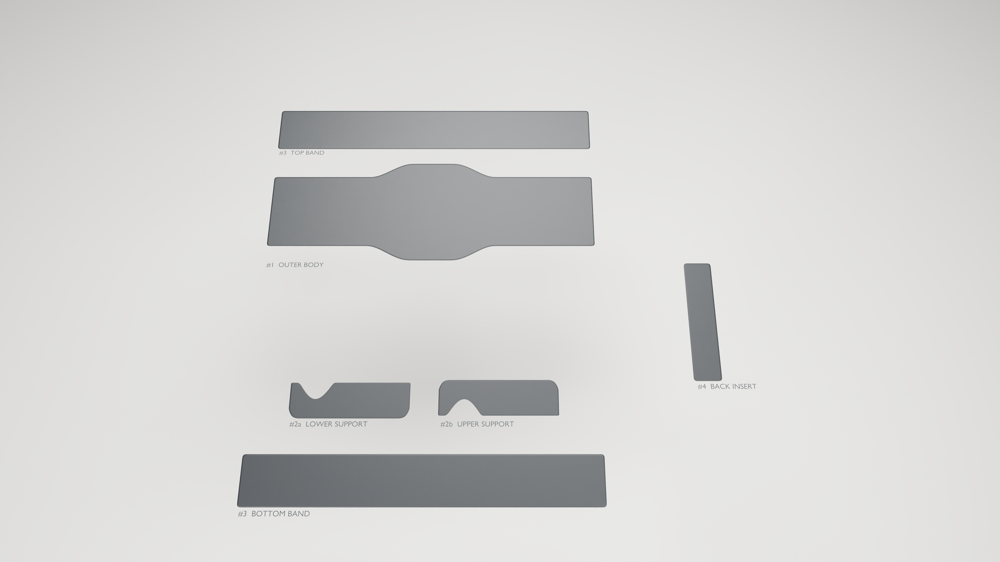
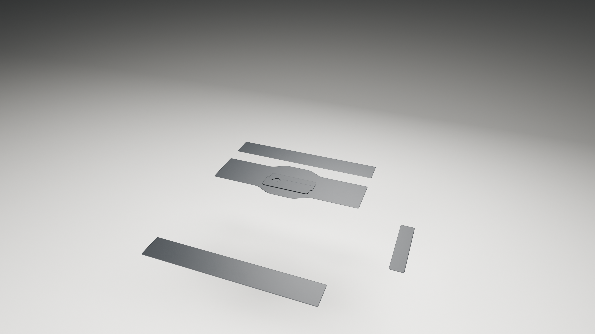
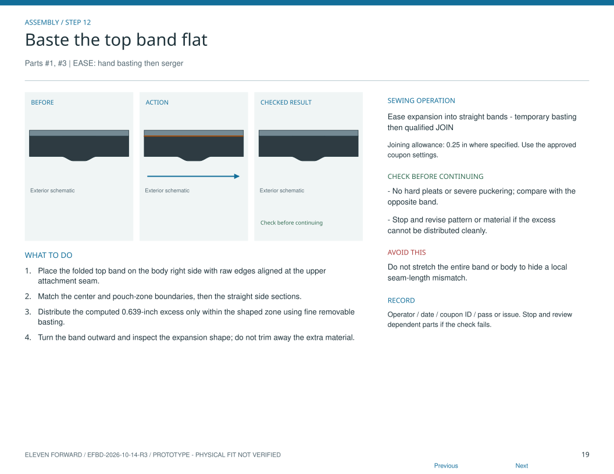
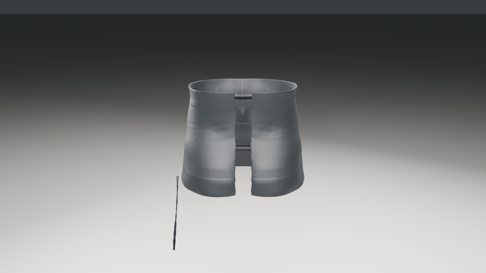
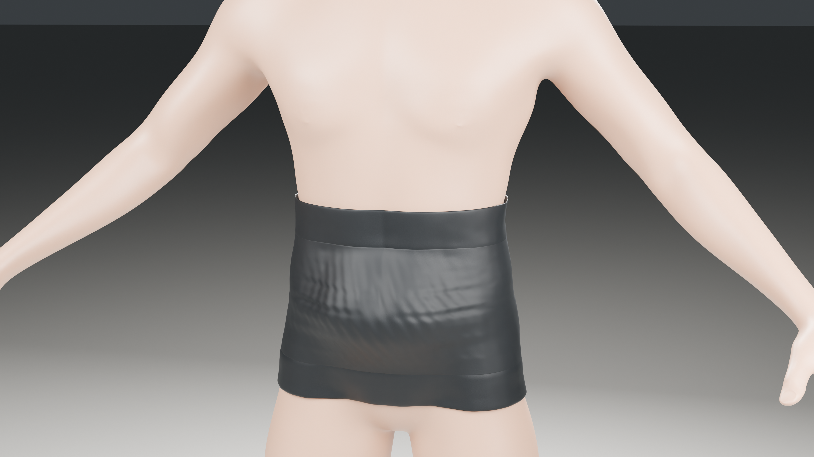
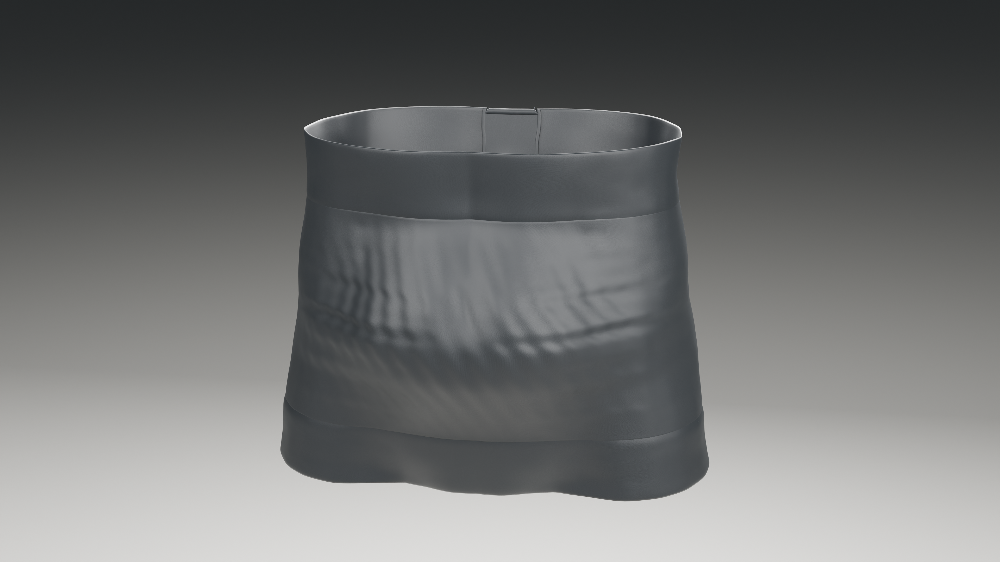

# Illustrated assembly-film storyboard

40 seconds, 24 fps. Black materials; no audio. Reference views below explain the construction stages. The band diagram is a manual reference, not a film frame. This is a provisional design visualization; physical fit remains unverified.

## 0–6 seconds: Six-piece catalog

Manual operation IDs: CUT.

## 6–14 seconds: Interior supports

Manual operation IDs: EDGE, POCKET.

## 14–22 seconds: Matching bands fold and attach

Manual operation IDs: FOLD, EASE, JOIN.

## 22–28 seconds: Full-height back insert

Manual operation IDs: HEM, JOIN.

## 28–34 seconds: Visible torso fit

Manual operation IDs: completed-product inspection.

## 34–40 seconds: Fitted invisible-wearer hero

Manual operation IDs: completed-product inspection.

