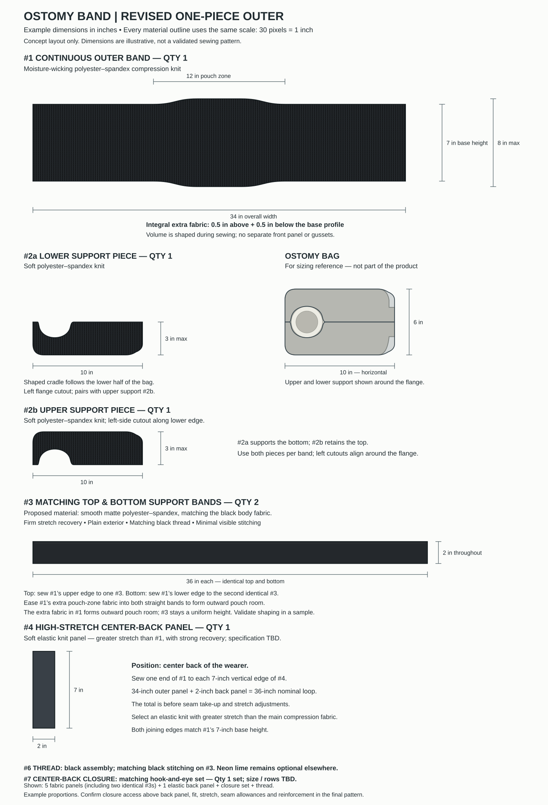

# Eleven Forward Band Design

A synchronized ostomy-band material layout and illustrated prototype sewing manual.

**[Read the assembly manual](manual/index.md)** · **[Download the printable PDF](manual/assembly-manual.pdf)** · **[Open the material and cutting layout](design/ostomy-band-scaled-layout.svg)**



## What is included

- A material catalog, cutting guide, machine/threading guidance, and expansion check.
- Twenty illustrated assembly steps, one per editable SVG page.
- A bookmarked, US Letter landscape PDF, research appendix, and blank prototype worksheets.
- A shared design specification, generated documentation, impact-review rules, regression tests, and GitHub Actions checks.

The current revision uses open folded top and bottom bands joining a full-height elastic back insert. The instruction pages distinguish finished targets from cut dimensions and allowances. No physical fit or performance is claimed: expansion, retention, extension and laundering checks remain **requires retest**.

## Build and verify

Python 3.12 is the supported runtime. Install dependencies in a virtual environment:

```sh
python -m venv .venv
source .venv/bin/activate
pip install -r requirements.txt
python scripts/build.py
python scripts/verify.py
python -m unittest discover -s tests -v
```

The build is deterministic and produces the layout, SVG pages, PDF, tables and manifests. Verification regenerates in a temporary directory and checks the committed files without changing them. GitHub Actions verifies pushes and pull requests; branch protection has not been configured by this project.

## Change either the design or the manual safely

1. Read [AGENTS.md](AGENTS.md) and answer the required downstream-impact question.
2. Edit shared facts in `design/design-spec.json`; edit instructional prose in `manual/source/steps.json`.
3. Review dependent parts, seam lengths, materials, instructions and inspection requirements. Ask the owner about new design choices.
4. Add or update the revision's impact record in `docs/changes/`. Set its `reviewed_source_hash` only after reviewing the source; obtain the value with `python scripts/review_hash.py`.
5. Relevant changes invalidate physical results. New verified results need a dated evidence record linked to the exact source hash and design facts.
6. Build, verify, run tests, render and visually inspect affected pages. Commit source and all generated changes together.

Direct edits to generated SVGs or the PDF fail verification. A visual edit request must be translated back into shared source, not silently accepted as a second authority. History under `design/history/` is intentionally excluded from current-output consistency checks.

## Documentation

- [Current specification](docs/DESIGN_SPEC.md)
- [Design context and remaining prototype work](docs/DESIGN_CONTEXT.md)
- [Sources and research limits](docs/RESEARCH.md)
- [Current impact review](docs/changes/R2.json)
- [Current physical-check status](design/design-spec.json)

The 30-unit/inch master layout is proportional; ordinary screen display and print do not make it a 1:1 cutting pattern. Detail illustrations in the manual are schematic. The bag is a sizing reference, not a product component. Sewing settings and seam allowances are prototype choices, not a certification or a verified branded-material specification.

No license has been selected. Public visibility alone does not grant a license to reuse the design.
